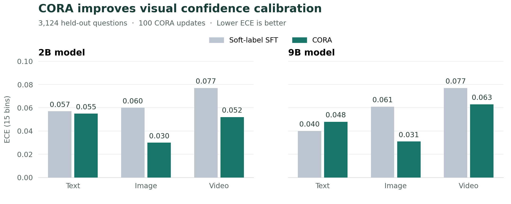
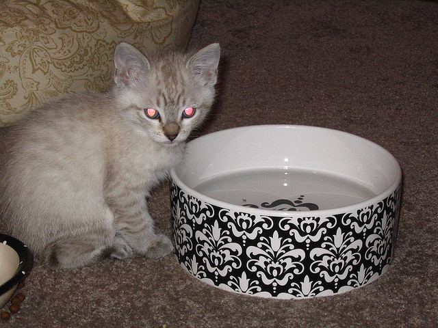
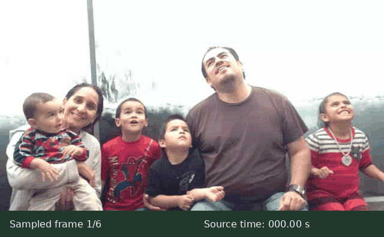
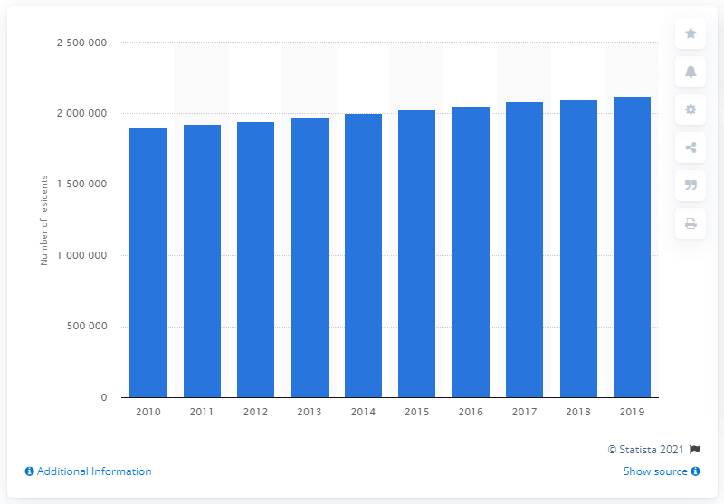

# CORA

**Confidence calibration for decisions across text, images, and video.**

[🤗 Model Weights](https://huggingface.co/wjnwjnwj/UniJev) · [Results](#results) · [Case Gallery](#case-gallery) · [Quick Start](#quick-start) · [Training](#training) · [Data](#data)

CORA trains multimodal decision models to express confidence that reflects how often they are correct. Given text, an image, or a video and a set of candidate answers, the model scores the candidates directly and returns an explicit probability distribution. This gives applications a decision and a confidence score to use for routing, filtering, or requesting human review.

CORA grounds confidence in **the accuracy of the model's own current predictions**. Predictions with similar confidence share a calibration target: their observed accuracy. These targets are refreshed as the model learns, keeping confidence training tied to its evolving decision behavior.

- **Three modalities, one interface.** Text, image, and video tasks share a model and training pipeline, with support for multiple-choice questions, binary judgments, and ordinal scores.
- **Direct candidate scoring.** A shared decision head produces answer probabilities without generating and parsing a text response.
- **Two-stage training.** Soft-label SFT builds the decision capability; CORA then trains confidence against observed accuracy.
- **2B and 9B models.** Both sizes use Qwen3.5 backbones, with LoRA adaptation, a trainable vision merger, and a lightweight decision head.

This repository includes the SFT and CORA training code, configurations for both model sizes, launch scripts, and 10 training examples per modality.

## Results

**At 2B, CORA reduces image calibration error by 50% and video calibration error by 32.5%, with per-modality accuracy changing by at most 0.3 percentage points.** These are relative reductions in expected calibration error (ECE) from the soft-label SFT initialization.

The paper evaluates **3,124 held-out questions**: 764 text, 1,858 image, and 502 video questions, with training and test data separated by source group. Both CORA scales are evaluated after **100 supervised calibration updates**. Accuracy is reported in percent; ECE uses **15 equal-width evaluation bins**, and lower is better.

### Soft-label SFT → CORA



| Scale | Modality | SFT accuracy ↑ | CORA accuracy ↑ | SFT ECE ↓ | CORA ECE ↓ |
| --- | --- | ---: | ---: | ---: | ---: |
| 2B | Text | 72.0 | 71.9 | 0.057 | **0.055** |
| 2B | Image | 83.3 | 83.6 | 0.060 | **0.030** |
| 2B | Video | 74.7 | 74.5 | 0.077 | **0.052** |
| 9B | Text | 80.8 | 81.0 | **0.040** | 0.048 |
| 9B | Image | 82.8 | 82.6 | 0.061 | **0.031** |
| 9B | Video | 77.5 | 77.5 | 0.077 | **0.063** |

Bold marks the lower ECE within each SFT/CORA pair. The largest gains are on image and video. At 9B, these gains persist with accuracy changes of at most 0.2 percentage points, while **text ECE increases from 0.040 to 0.048**. At 2B, text ECE is nearly unchanged.

Candidate-distribution negative log-likelihood (NLL, lower is better) also improves at 2B: **0.693 → 0.643** on text, **0.482 → 0.449** on image, and **0.648 → 0.620** on video.

### Alignment ablations

The following 2B ablations share the same soft-label SFT initialization, training mixture, and 100-update budget. Each variant changes one factor from the default: **10 training bins, 256 questions per group, and minimum bin support of 20**. Training bins are separate from the 15 bins used to evaluate ECE.

| Variant | Text ECE ↓ | Image ECE ↓ | Video ECE ↓ |
| --- | ---: | ---: | ---: |
| **CORA (default)** | **0.055** | 0.030 | 0.052 |
| Replace bin accuracy with bin mean confidence | 0.274 | 0.162 | 0.240 |
| Replace confidence bins with one global target | 0.158 | 0.127 | 0.090 |
| Update the decision head only | 0.083 | 0.032 | 0.061 |
| Reduce minimum bin support from 20 to 1 | 0.095 | **0.026** | **0.045** |

Removing **correctness supervision** or **confidence-conditioned targets** raises ECE in all three modalities. Updating only the decision head also trails the default. Bin support exposes a tradeoff: support 1 improves image and video ECE but worsens text ECE.

<details>
<summary><strong>Comparison with five local RLCD continuations (2B)</strong></summary>

All methods below start from the same soft-label SFT checkpoint. CORA uses 100 supervised calibration updates; the five RLCD recipes each use a 500-step budget. The training budgets therefore differ.

| Method | Continuation updates | Text ECE ↓ | Image ECE ↓ | Video ECE ↓ |
| --- | ---: | ---: | ---: | ---: |
| Shaped RLCD | 500 | 0.220 | 0.099 | 0.173 |
| GRPO | 500 | 0.234 | 0.114 | 0.183 |
| CtR (OpenJev-RLCD) | 500 | 0.095 | **0.025** | 0.054 |
| RLCD-lite | 500 | 0.250 | 0.143 | 0.220 |
| Rewarding Doubt | 500 | 0.230 | 0.107 | 0.178 |
| **CORA** | **100** | **0.055** | 0.030 | **0.052** |

CORA has the lowest text and video ECE among these local continuations. CtR has the lowest image ECE, while its text ECE rises from the SFT initialization's 0.057 to 0.095. These results support direct confidence-bin supervision as an effective calibration approach without a reinforcement stage.

</details>

Values come from the latest manuscript's main results and ablation tables. [Metric snapshot and figure source](docs/results/README.md).

## Case Gallery

These examples show recorded predictions from the paper's held-out evaluation. **SFT** is the 2B soft-label initialization; **CORA** is the 2B model after 100 calibration updates. Candidate probabilities are shown as percentages, rounded to one decimal place. The original probabilities, labels, and case identifiers are available in [the case snapshot](docs/cases/predictions.json).

### Text · Answering a science question

> What is the term for the force that brings objects toward the earth?

| Candidate answer | SFT | CORA |
| --- | ---: | ---: |
| centrifugal | 1.4% | 0.2% |
| light | 0.8% | 0.1% |
| weight | 23.0% | 14.8% |
| **gravity — ground truth** | **74.8%** | **84.9%** |

Both models select **gravity**. The shared decision head returns the candidate distribution directly.

### Image · Counting objects



**Question:** How many bowls does the cat have?

| Candidate answer | SFT | CORA |
| --- | ---: | ---: |
| 3 | 1.7% | 0.4% |
| 2 | 17.0% | 12.4% |
| **1 — ground truth** | **77.9%** | **86.5%** |
| 0 | 3.4% | 0.8% |

Both models choose **1 bowl**, with different confidence distributions over the alternatives.

### Video · Recognizing a scene



The animation replays six sampled frames from the paper, with their source timestamps. It has no audio. [Open or download the MP4 preview](docs/cases/video-scene.mp4).

**Question:** Where is this happening?

| Candidate answer | SFT | CORA |
| --- | ---: | ---: |
| **tourist lift. — ground truth** | 42.3% | **56.0%** |
| park. | **50.3%** | 41.9% |
| forest. | 2.9% | 0.9% |
| bowling alley. | 1.8% | 0.5% |
| stage. | 2.7% | 0.8% |

SFT selects **park**; CORA selects the correct answer, **tourist lift**. Calibration training updates the model, so it can change the selected answer as well as its confidence.

<details>
<summary><strong>A remaining error · Reading a chart</strong></summary>



**Question:** How many people lived in the Columbus metropolitan area in 2019?

**Ground truth:** 2,104,194.

| Model | Selected answer | Confidence | Correct? |
| --- | --- | ---: | --- |
| SFT | 2,104,195 | 62.1% | No |
| CORA | 2,104,195 | 61.3% | No |

This prediction remains incorrect after calibration. Calibration describes groups of predictions; individual answers can still be wrong.

</details>

These selected cases illustrate model behavior. The [aggregate results](#results) measure accuracy and calibration across the full evaluation suite. [Case sources and preview details](docs/cases/README.md).

## Models

Model weights: **[UniJev on Hugging Face](https://huggingface.co/wjnwjnwj/UniJev)**.

| Backbone | Modalities | SFT config | CORA config |
| --- | --- | --- | --- |
| Qwen3.5-2B | Text, image, video | [sft_2b.json](train/configs/sft_2b.json) | [cora_2b.json](train/configs/cora_2b.json) |
| Qwen3.5-9B | Text, image, video | [sft_9b.json](train/configs/sft_9b.json) | [cora_9b.json](train/configs/cora_9b.json) |

Training uses a local Qwen3.5 base model directory containing its weights, tokenizer, and processor. Set `MODEL_PATH` to the matching 2B or 9B directory. Base models and trained checkpoints are stored separately from this code repository.

## Quick Start

### Install

Use Python 3.10 and a CUDA GPU with BF16 support. Run the following commands from the repository root:

```bash
python3.10 -m venv .venv
source .venv/bin/activate
python -m pip install --upgrade pip
python -m pip install torch==2.6.0 torchvision==0.21.0 \
  --index-url https://download.pytorch.org/whl/cu124
python -m pip install -r requirements.txt
```

### Run the examples

Try the complete SFT → CORA workflow on a single GPU:

```bash
export MODEL_PATH=/absolute/path/to/Qwen3.5-2B
CUDA_VISIBLE_DEVICES=0 bash train/run_sft_2b.sh --smoke
CUDA_VISIBLE_DEVICES=0 bash train/run_cora_2b.sh --smoke
```

Each stage runs one training update on the bundled examples. CORA automatically loads the checkpoint from the preceding SFT step. For 9B, change the model path and use `run_sft_9b.sh` and `run_cora_9b.sh`.

To check the example data without loading a model or using a GPU:

```bash
bash train/run_cora_2b.sh --smoke --check-data
```

## Training

Both model sizes follow the same two stages:

1. **Soft-label SFT** trains the candidate distribution on labeled text, image, and video examples.
2. **CORA** samples questions across modalities, groups predictions by confidence, and trains each confidence score toward its group's current accuracy.

Set the paths to your full training JSONL file and media directory:

```bash
export TRAIN_DATA=/absolute/path/to/trimodal_full_train.jsonl
export MEDIA_ROOT=/absolute/path/to/media/root
```

### Qwen3.5-2B

```bash
export MODEL_PATH=/absolute/path/to/Qwen3.5-2B

# Stage 1: soft-label SFT on 8 GPUs
CUDA_VISIBLE_DEVICES=0,1,2,3,4,5,6,7 bash train/run_sft_2b.sh

# Stage 2: CORA on 4 GPUs
CUDA_VISIBLE_DEVICES=0,1,2,3 bash train/run_cora_2b.sh
```

### Qwen3.5-9B

```bash
export MODEL_PATH=/absolute/path/to/Qwen3.5-9B

# Stage 1: soft-label SFT on 4 GPUs
CUDA_VISIBLE_DEVICES=0,1,2,3 bash train/run_sft_9b.sh

# Stage 2: CORA on 4 GPUs
CUDA_VISIBLE_DEVICES=0,1,2,3 bash train/run_cora_9b.sh
```

The launch scripts select the corresponding configuration and SFT checkpoint automatically. Full settings are in [`train/configs/`](train/configs). For 9B training, we recommend GPUs with 80 GB of memory and sufficient host memory for SFT activation offload.

To start CORA from an existing SFT checkpoint, set `SFT_CHECKPOINT`:

```bash
SFT_CHECKPOINT=/absolute/path/to/sft/checkpoint-directory \
  CUDA_VISIBLE_DEVICES=0,1,2,3 bash train/run_cora_2b.sh
```

Outputs are saved under `outputs/` by default. Use `OUTPUT` to choose another directory, or append `--resume` to continue an interrupted run with the same configuration. Explicit path settings also apply to smoke runs; unset them to return to the bundled examples.

## Data

Training data uses a shared JSONL schema for all three modalities. Each record contains a context, one or more questions with candidate answers, and target probabilities. Supported question types are `choice` (multiple choice), `noul` (true/false), and `score` (ordered descriptions).

The [`data/`](data) directory includes **10 text, 10 image, and 10 video records**, with small images and video frame caches ready for the example workflow. See [`examples.jsonl`](data/examples.jsonl) for all three modalities and [`manifest.json`](data/manifest.json) for sample sources.

<details>
<summary>Example record and media paths</summary>

```json
{
  "group_id": "unique-source-group",
  "request": {
    "state": "The store closes at 6 pm.",
    "questions": {
      "q1": {
        "type": "choice",
        "instructions": "When does the store close?",
        "criteria": {"A": "6 pm", "B": "8 pm"}
      }
    }
  },
  "targets": {"q1": {"probabilities": {"A": 1.0, "B": 0.0}}}
}
```

For image and video inputs, `state` can be an object containing a `messages` list with `text`, `image_url`, and `video_url` content. Relative media paths are resolved against `MEDIA_ROOT`; absolute paths are also supported.

</details>

## Repository Structure

```text
data/                  # Example records and media
docs/cases/            # README gallery, saved predictions, and preview assets
docs/results/          # Paper metrics, calibration comparison, and figure source
train/
  common/              # Shared model and data utilities
  sft.py               # Soft-label SFT
  cora/                # CORA training
  configs/             # 2B and 9B training recipes
  run_*.sh             # Launch scripts for both stages
requirements.txt       # Python dependencies
```
